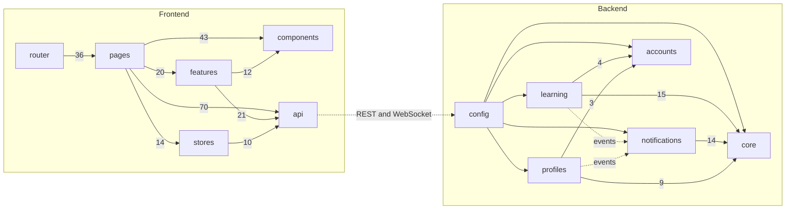

# Django LMS

A learning management system and professional network: courses with lessons, quizzes and
certificates; profiles, connections and groups; jobs and companies; messaging and notifications.
Django and Django REST Framework on PostgreSQL and Redis, with a Vue 3 frontend.

[](https://github.com/AbdullahBakir97/Django--LMS--Learning-Management-System/actions/workflows/ci.yml)
[](LICENSE)


The full design, the domain map and the rules the code follows are in
[docs/architecture.md](docs/architecture.md).

## Status

The project is being rebuilt in phases, one pull request each. Done so far: the backend
foundation, accounts with JWT auth and email verification, profiles with experience, education,
skills and endorsements, the Vue frontend, courses with lessons, quizzes, progress and
certificates, and live notifications over one WebSocket per user. Network, community, careers and
messaging follow.

## Codebase map

Generated from the code graph (graphify, tests and migrations left out): arrows point from a
module to what it uses, and the number is how many links the graph found. Contexts use only the
layers below them: `notifications` hears about enrolments and certificates through events and
never imports `learning`.



The full graph (every module, class and function, with an Obsidian vault and canvas) is
regenerated locally with `graphify backend frontend --obsidian`; it is not committed.

## Repository layout

| Path | What it is |
|---|---|
| `backend/` | Django project: `config/` (settings, ASGI, Celery), `apps/core/` (kernel), `apps/<context>/` per bounded context |
| `frontend/` | Vue 3 single-page app: `src/api` (typed client), `src/stores`, `src/components/ui`, `src/pages`, `src/features` |
| `DESIGN.md`, `PRODUCT.md` | The visual system and the product brief the frontend follows |
| `docs/` | Architecture, diagrams, decisions |
| `docker-compose.yml` | PostgreSQL, Redis, backend and worker for local development |

## Getting started

Requirements: Docker with Compose, or Python 3.12 with PostgreSQL 16 and Redis 7 running locally.

```bash
cp .env.example .env            # set DJANGO_SECRET_KEY
make dev                        # builds and starts postgres, redis, backend, worker
make migrate
docker compose exec backend python manage.py createsuperuser
```

Then open <http://localhost:5173> for the app, <http://localhost:8000/api/docs/> for the API and
<http://localhost:8000/admin/>.

Without Docker:

```bash
cd backend
pip install -r requirements-dev.txt
export $(grep -v '^#' ../.env | xargs)
python manage.py migrate && python manage.py runserver
```

| Command | Does |
|---|---|
| `make test` | backend pytest and frontend unit tests |
| `make lint` / `make fmt` | ruff, ESLint, Prettier and vue-tsc |
| `cd frontend && pnpm test:e2e` | Playwright smoke test against the dev server |
| `pre-commit install` | run the same checks before each commit |

## Contributing

Read [CONTRIBUTING.md](CONTRIBUTING.md) and [docs/architecture.md](docs/architecture.md) first.
Security issues go through [SECURITY.md](SECURITY.md). Licensed under the [MIT License](LICENSE).
