# Django LMS

A learning platform and professional network in one: courses with quizzes and verifiable
certificates, a feed and groups, events, jobs with private applications, live messaging and
notifications. Django REST Framework on PostgreSQL and Redis, with a Vue 3 frontend.

[](https://github.com/AbdullahBakir97/Django--LMS--Learning-Management-System/actions/workflows/ci.yml)
[](LICENSE)

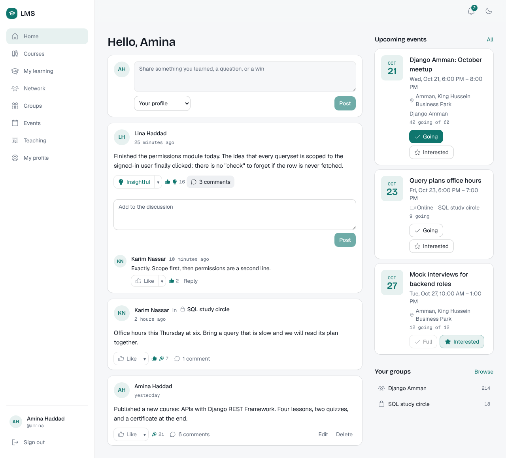

## What it does

| Area | For learners | For instructors, organisers and employers |
|---|---|---|
| **Learning** | Catalogue, enrolment with prerequisites, lessons in markdown with video, quizzes, progress, a PDF certificate anyone can verify | Course editor, lessons, quiz builder, publishing |
| **Discussion** | Comments, replies and reactions on lessons and posts | Moderation of discussions on your own lessons and groups |
| **Profiles** | Experience, education, skills and endorsements, a portfolio, badges earned along the way, recommendations from connections that you approve | |
| **Network** | Follow, connect, people who share your skills | |
| **Community** | A feed, public and private groups, events with RSVPs | Group roles and approvals, events with capacity |
| **Careers** | Job search with skill match, saved jobs, applications with a private résumé | Company pages, job posts, an applicant pipeline |
| **Messaging** | Direct and group conversations, live, with typing and read receipts | |
| **Notifications** | Live in the app, email for what matters, per-kind preferences | |

Accounts use email sign-in with verification and password reset. Every list is cursor-paged,
every error is an [RFC 9457](https://www.rfc-editor.org/rfc/rfc9457) problem document, and the
API is described by OpenAPI at `/api/docs/`.

## Screenshots

| | |
|---|---|
| 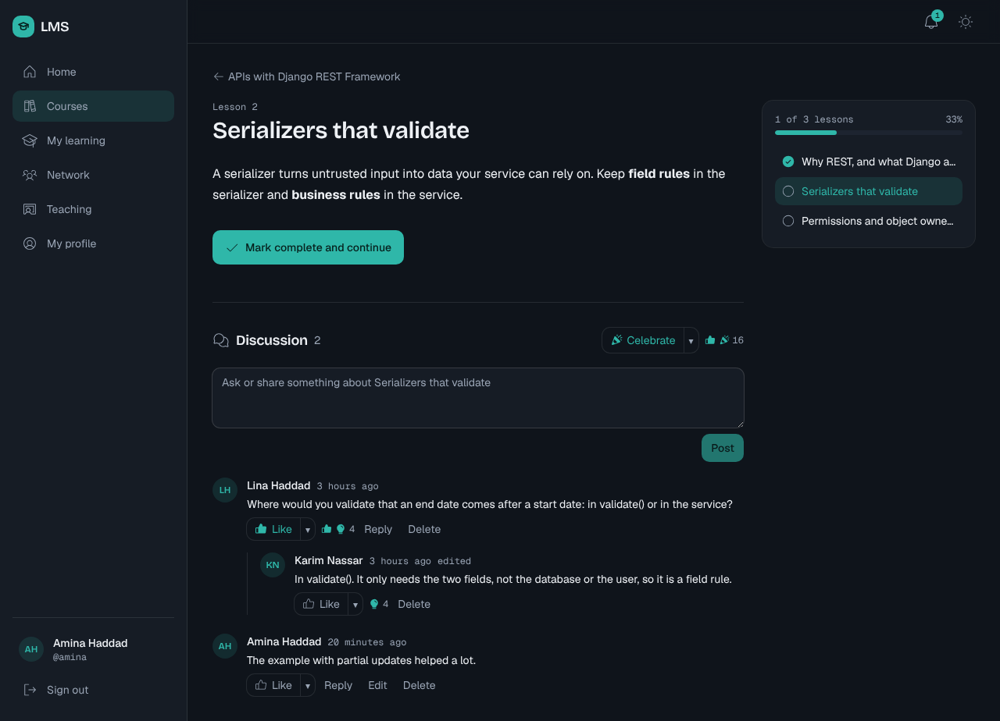 | 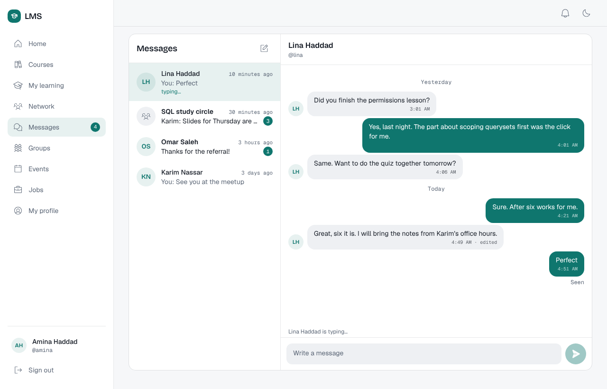 |
| Lesson player and its discussion | Live messaging |
| 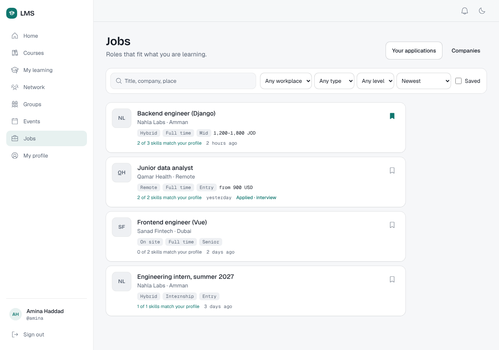 | 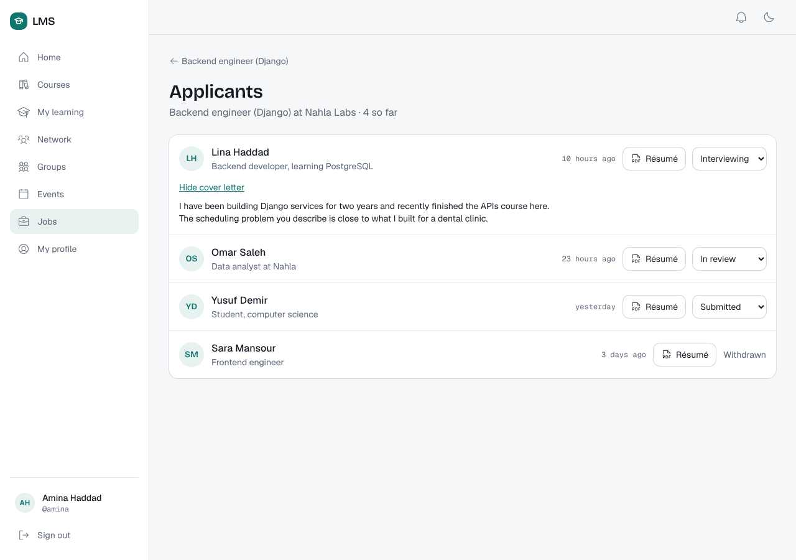 |
| Jobs matched to your skills | The hiring team's applicant view |
| 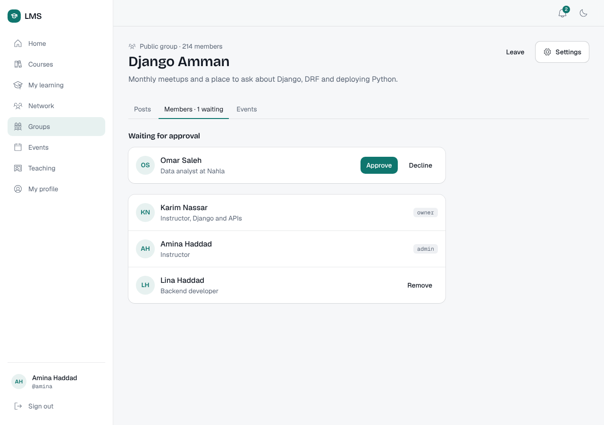 | 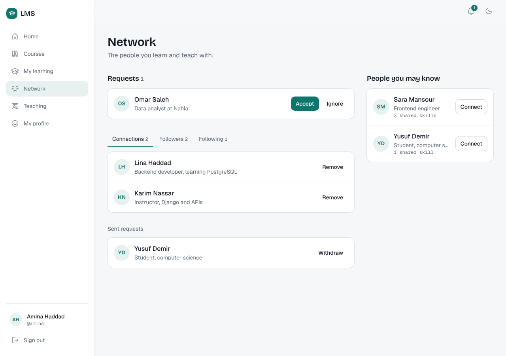 |
| Group members and requests | Network and suggestions |
| 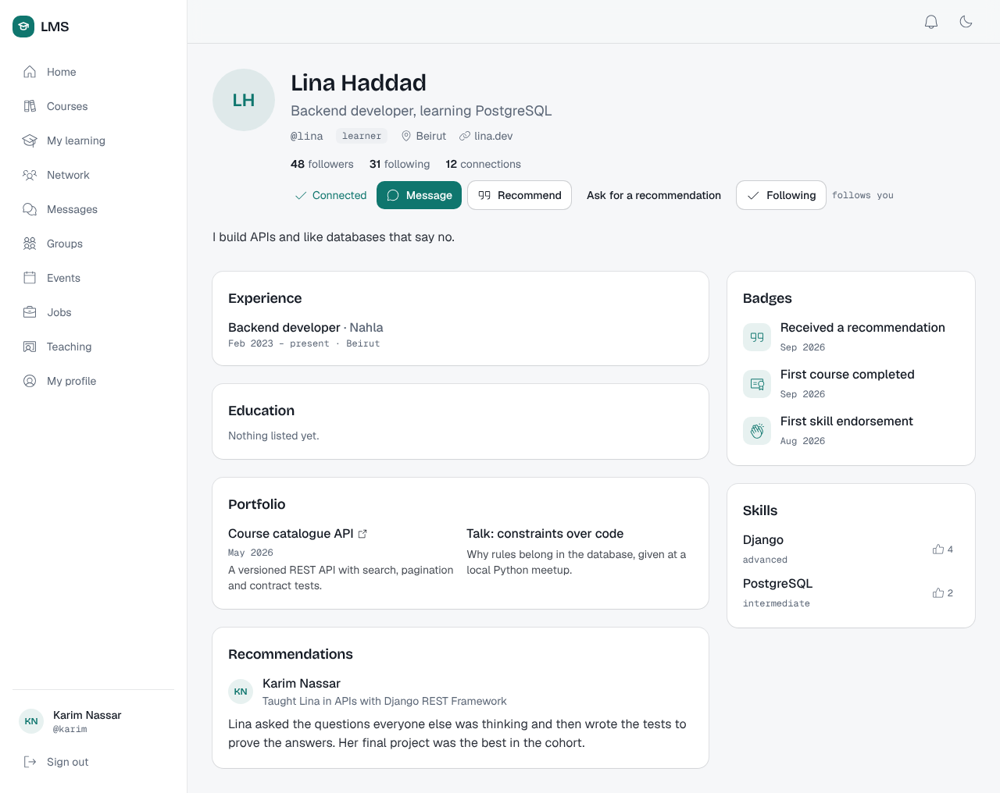 | |
| A profile with portfolio, badges and recommendations | |

Light and dark themes, and every screen works at phone width. More in
[docs/screenshots](docs/screenshots).

## Architecture

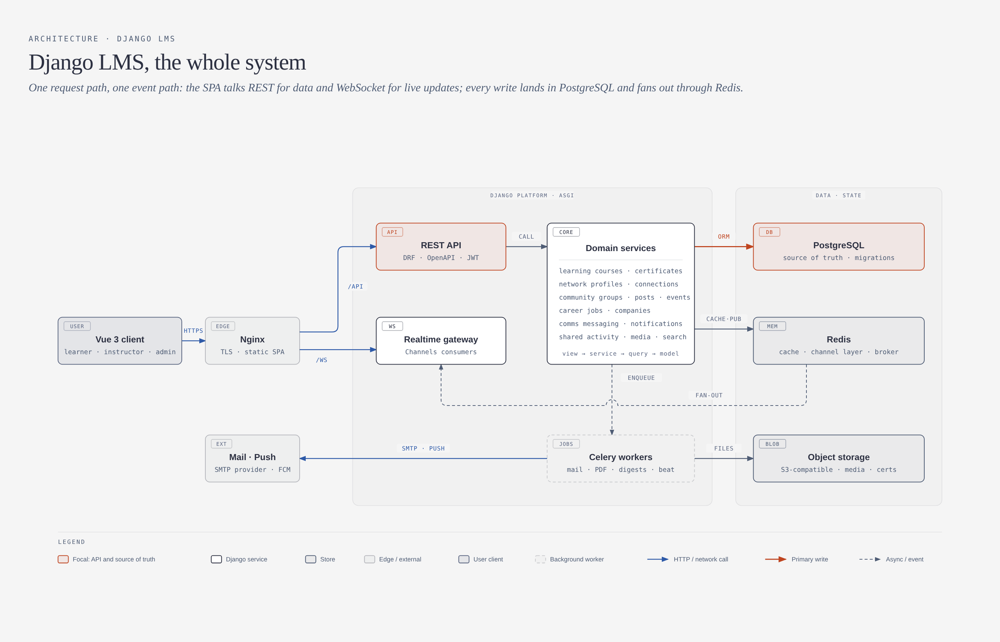

Nine bounded contexts in five layers, each importing only from the layers below. Anything that
needs to travel upward is a domain event published after commit. The design, the rules and the
reasons are in [docs/architecture.md](docs/architecture.md).

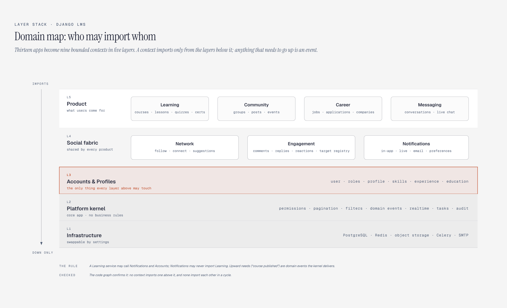

### Codebase map

Generated from the code graph (graphify; tests, migrations and admin modules left out): arrows
point from a module to what it uses, and the number is how many links the graph found. Dotted
arrows are domain events: `notifications` hears about enrolments, follows and comments without
importing the contexts that publish them.

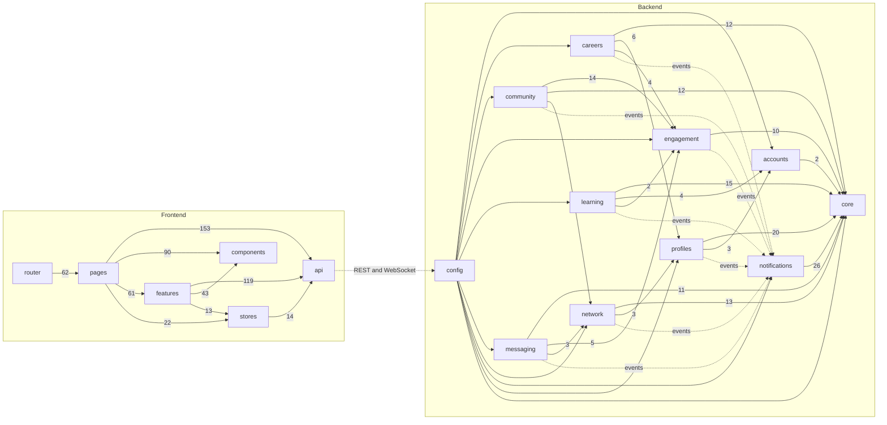

The full graph (every module, class and function, with an Obsidian vault and canvas) is
regenerated locally with `graphify backend frontend --obsidian`; it is not committed.

## Getting started

Requirements: Docker with Compose. (Or Python 3.12, Node 22 with pnpm, PostgreSQL 16 and Redis 7.)

```bash
cp .env.example .env            # set DJANGO_SECRET_KEY
make dev                        # postgres, redis, backend, worker and the app with hot reload
make migrate
make seed                       # demo people, courses, groups, events, jobs and conversations
```

Open <http://localhost:5173>. The demo accounts are `karim`, `amina` (instructors), `lina`,
`omar`, `sara`, `yusuf` and `rana` (who hires for Nahla Labs), each as `<name>@demo.lms`. They
share one password: `make seed` prints it, or set `DEMO_PASSWORD` in `.env` to choose it. The API
docs are at <http://localhost:8000/api/docs/>.

| Command | Does |
|---|---|
| `make test` | backend pytest and frontend unit tests |
| `make e2e` | Playwright smoke test against the dev server |
| `make lint` / `make fmt` | ruff, ESLint, Prettier and vue-tsc |
| `make schema` | write the OpenAPI schema, failing on any warning |
| `make help` | every target |

## Production

Two images: the API (also used for the Celery worker and migrations) and nginx serving the app.
`make prod-up` runs the whole stack from `docker-compose.prod.yml`; pushing a `v*` tag publishes
versioned images to the GitHub Container Registry. Settings, TLS, backups and the checklist are
in [docs/deployment.md](docs/deployment.md).

## Repository layout

| Path | What it is |
|---|---|
| `backend/` | Django project: `config/` (settings, ASGI, Celery), `apps/core/` (kernel), `apps/<context>/` per bounded context |
| `frontend/` | Vue 3 app: `src/api` (typed client), `src/stores`, `src/lib` (live connection), `src/components/ui`, `src/features`, `src/pages` |
| `DESIGN.md`, `PRODUCT.md` | The visual system and the product brief the frontend follows |
| `docs/` | Architecture, deployment, diagrams, screenshots |
| `docker-compose.yml`, `docker-compose.prod.yml` | Local development, and a production-like stack |

## Contributing

Read [CONTRIBUTING.md](CONTRIBUTING.md) and [docs/architecture.md](docs/architecture.md) first.
Changes are listed in [CHANGELOG.md](CHANGELOG.md). Security issues go through
[SECURITY.md](SECURITY.md). Licensed under the [MIT License](LICENSE).
